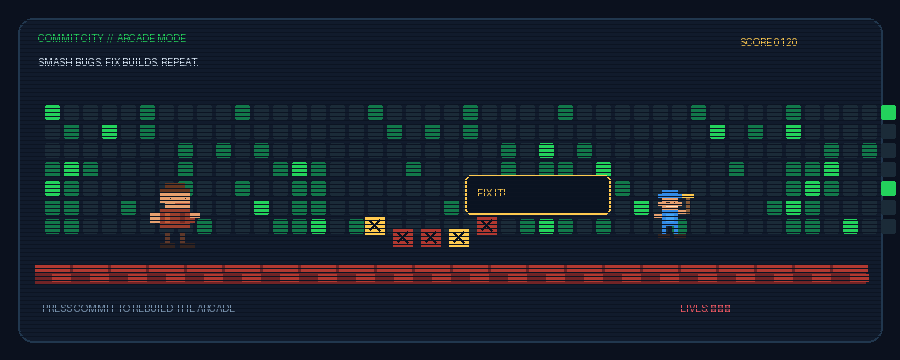

# GitHub Profile: Commit City Arcade

## Add the animated GIF to your profile

1. Create a **public repository named exactly like your GitHub username**.
2. Upload `commit-city.gif` to the repository's root.
3. Open `README.md` and click the pencil (Edit) icon.
4. Paste this snippet, then commit the changes.

```md
<div align="center">

# 🕹️ COMMIT CITY ARCADE

**Smash bugs. Fix builds. Repeat.**



*Every commit helps rebuild the arcade.*

</div>
```

If you put the GIF inside an `assets` folder, change the image path to `./assets/commit-city.gif`.

## Notes
- This is a looping animated GIF, not a playable game.
- It is a custom retro-arcade design inspired by classic pixel games.
- It is decorative and does not alter your real contribution history.
