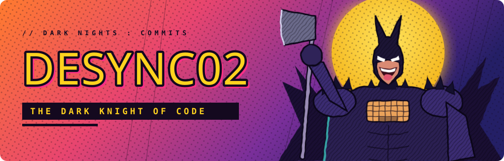
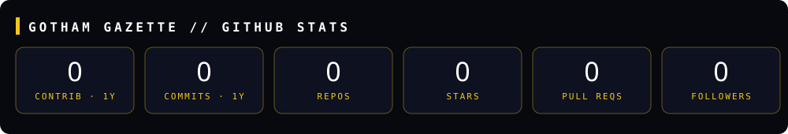

  

<h3 align="center">🦇 Patrolling the codebase of Gotham, one commit at a time</h3>

  
  
  
  

## 🦇 SECRET IDENTITY

| | |
|---|---|
| **ALIAS** | DeSync02 |
| **TRAINING** | Student — Machine Learning & Data Science |
| **THE JUSTICE LEAGUE (ORGS)** | _add your orgs / clubs_ |
| **BAT-CAVE (LOCATION)** | _add your city_ |
| **GADGETS** | VS Code · Jupyter · Colab |

## 🧰 UTILITY BELT

  
  
  
  
  
  

## 📰 GOTHAM GAZETTE

_Auto-refreshed every night at 12:00 AM (Manila) by GitHub Actions._

  
  

<i>"It's not who I am underneath, but what I commit that defines me."</i>

